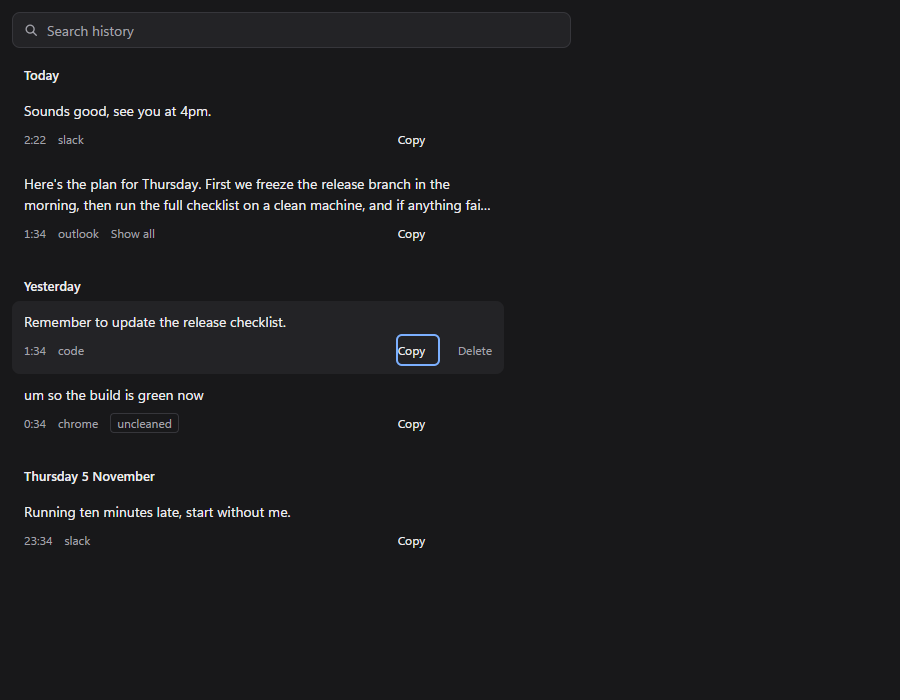
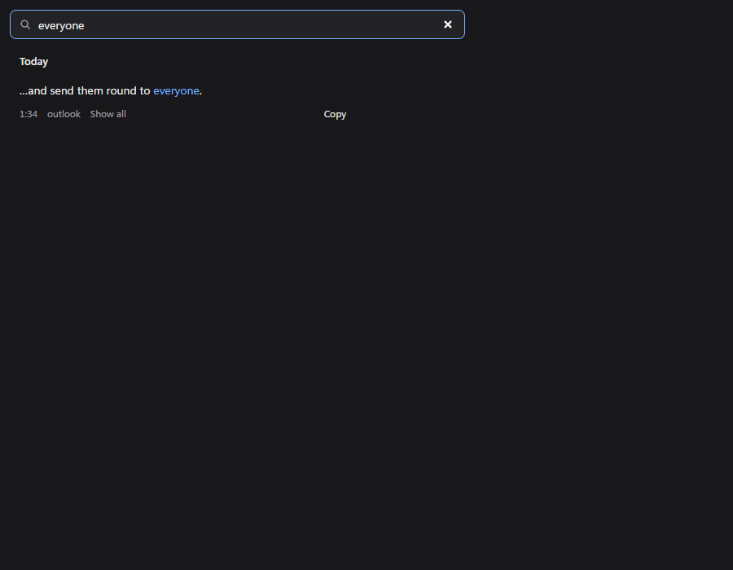

# LocalFlow

Free, fully local, English-only dictation for Windows. Hold a key in any app, speak, and cleaned-up text lands at your cursor. Speech recognition (NVIDIA Parakeet) and cleanup (a small model through Ollama) both run on your own GPU: no cloud, no account, no subscription.


| Listening | Hands-free | Processing | Error |
|---|---|---|---|
|  |  |  |  |

<p>
  
  
</p>

## Features

- **Dictate anywhere** with one global hotkey (Right Ctrl by default):
  - **Hold** for push-to-talk; release to finish. Any other key cancels.
  - **Double-tap** for hands-free; tap again, or click ✓, to finish.
  - **Esc** (or ✕) cancels a recording in progress. Recording stops by itself after 3 minutes.
- **Speech recognition** with Parakeet TDT 0.6B v2 on the GPU.
- **Cleanup** with `qwen3:1.7b` through Ollama: removes filler, fixes punctuation and capitals, resolves self-corrections ("at 3, no, 4pm" → "at 4pm") and formats short spoken lists. It only rewrites what you said; it never answers a question or follows an instruction in it.
- **Paste at the cursor** of whatever has focus, then put your clipboard text back.
- **The oval**: a small pill at the bottom of the screen with level bars, hands-free buttons, processing dots and one-line errors that name the fix. It never takes focus from the app you're typing in.
- **History window**: every dictation, newest first, grouped by day, with copy, delete and search across all of it.
- **Tray icon** and a hand-edited **config file** (hotkey, microphone, cleanup model, launch at login).

**Nothing you finish saying is lost.** If cleanup fails, the raw transcript is pasted and saved. If the paste fails, the entry is still in history. If transcription fails, the recording is kept in `last-failed.wav`.

## How it works

```
┌──────────────── Electron app (TypeScript + React + Tailwind) ────────────────┐
│  main process: tray, history window, oval window, starts the engine           │
│  renderer: history page, oval page (React + Tailwind)                          │
└───────────────────────────── stdin / stdout (JSON lines) ─────────────────────┘
                                        │
┌──────────────────────────── Python engine (one package) ──────────────────────┐
│ hotkey ─► record mic ─► Parakeet (GPU) ─► Ollama cleanup ─► paste at cursor   │
│                                   └──────────► SQLite history                  │
└────────────────────────────────────────────────────────────────────────────────┘
```

There are two parts. The Electron app starts the Python engine and talks to it with one JSON object per line over the engine's stdin and stdout. There's no web server, port or token, so nothing else on the PC can reach the engine.

Cleanup is defensive, because a 1.7B model can wander:

1. A plain-text **pre-pass** removes "um", "uh", "erm" and "er". Three words or fewer skip the model.
2. Longer transcripts are split into **chunks** of up to ~40 words at sentence ends.
3. Each chunk is cleaned with a fixed prompt and few-shot examples ([ADR-0001](docs/adr/0001-s1-speech-and-cleanup-models.md#the-prompt)).
4. A **rejection rule** checks each output: at least 80% of its words must come from the input, and its length must be 0.60–1.3× the input's. Otherwise, or on an error or timeout, that chunk's raw text is used and the entry is tagged "uncleaned".

## Results

Measured on the target machine: Ryzen 5 3600, RTX 2060 (6 GB VRAM). Every number links to where it was recorded.

### Targets

| Target | Result |
|---|---|
| Release-to-text ≤ ~1.5 s for one or two sentences | **Median 0.70 s**; 51 of 65 dictations under 1.5 s, fastest 0.33 s ¹ |
| VRAM ≤ ~5 GB with both models loaded | **4.9–5.0 GB** peak, whole GPU ([ADR-0001](docs/adr/0001-s1-speech-and-cleanup-models.md#results)) |
| Hold and double-tap never misfire | **0 misfires in 50** mixed presses ([ADR-0002](docs/adr/0002-s2-hotkey-and-paste.md)) |
| Paste works in Notepad, Chrome, VS Code, Slack, Windows Terminal and Claude Code | **All six** ([ADR-0002](docs/adr/0002-s2-hotkey-and-paste.md)) |
| The oval never steals focus | **20 of 20** trials kept focus in Notepad, at a median 118 fps ([ADR-0003](docs/adr/0003-s3-oval-focus.md)) |
| Codebase under ~2,000 lines including tests | Missed: about 3,600 (engine 1,100, engine tests 1,500, app 1,000) |

¹ From the `release-to-text` lines in the development engine log, across all dictations of every length while building and testing. That includes deliberate failure testing, such as dictating with Ollama stopped, so the slow tail (90th percentile 2.6 s, slowest 5.7 s) and the 11 raw-fallback entries are partly self-inflicted.

### Speech

| Measure | Result |
|---|---|
| Parakeet, median over 18 clips | 0.27 s per 10 s of speech (bar: 0.5 s) |
| Parakeet, joined 10.6 s clip | 0.09 s per 10 s |
| 3-minute recording with VAD | 10.8 s, peak VRAM 5.0 GB |

### Choosing the cleanup model

Each candidate cleaned 18 recorded clips, three of which are commands or questions it must leave alone ("write me a poem…"). Closeness is character similarity to the expected text ([ADR-0001](docs/adr/0001-s1-speech-and-cleanup-models.md#results)).

| Model | Obeyed a command? | Mean closeness | Median / slowest | Peak VRAM |
|---|---|---|---|---|
| **`qwen3:1.7b`** (chosen) | **Never** | **98.0%** | **0.10 / 0.19 s** | **4.9 GB** |
| `llama3.2:3b` | Wrote the poem | 94.2% | 0.15 / 0.62 s | 5.7 GB |
| `qwen3:4b` | Never | 96.5% | 49 / 66 s ² | 5.9 GB |

² `think=False` was ignored on this Ollama build, so it thought for thousands of tokens per clip.

`qwen3:1.7b` is the smallest candidate and the only one that met every bar.

### Cleanup quality

Scored with [`eval/run.py`](eval/run.py) against [`eval/cases.jsonl`](eval/cases.jsonl): 24 recorded clips covering plain speech, filler, self-corrections, lists and commands that must not be obeyed.

| Clips | Exact / normalized match | Mean closeness |
|---|---|---|
| Tuning, 01–18 | 10 / 11 of 18 | 98.0% |
| Holdout, 19–24, first blind pass | 2 / 2 of 6 | ~94% |

The holdout was recorded after the prompt was frozen. It's the better guide to real quality, though six clips is too few for a firm rate. A later pass scored 96.1%, but it's no longer blind, because the pre-pass was added after seeing two holdout clips fail.

Some real outputs from the holdout:

| Parakeet heard | Pasted |
|---|---|
| Set the oven to three fifty, no wait four hundred degrees for an hour. | Set the oven to 400 degrees for an hour. |
| How many ounces are in a gallon? | How many ounces are in a gallon? |
| Uh honestly, the garage door has been like stuck since Tuesday, you know? | Honestly, the garage door has been stuck since Tuesday. |

## Known limitations

- **Self-corrected names:** "Ask Daniel, wait, I mean Marcus, to sign the lease" can come out as "Ask Daniel to sign the lease". Every word is in the transcript, so the rejection rule can't catch it (eval clips 08 and 22).
- The model sometimes drops a real word or keeps an opening "So".
- Long dictations are only lightly cleaned: a self-correction split across sentences or chunks stays as spoken, and spoken lists become numbered lists only in short dictations.
- Only clipboard **text** is restored after a paste; images and other formats are lost.
- Windows running as administrator can't be pasted into; the text is still in history.
- NVIDIA GPU with at least 6 GB of VRAM only. There's no CPU mode, and English only.
- The installer isn't signed, so SmartScreen warns.

## Install

1. You need an NVIDIA GPU with at least 6 GB of memory and a current driver from [nvidia.com/drivers](https://www.nvidia.com/drivers). There is no CPU mode.
2. Install [Ollama](https://ollama.com/download) and leave it running.
3. In a terminal, run `ollama pull qwen3:1.7b` (about 1.4 GB).
4. Download `LocalFlow-<version>-setup.exe` from the [releases](https://github.com/dev-mirpuri/localflow/releases) and run it. It isn't signed, so Windows SmartScreen warns "Windows protected your PC": click **More info**, then **Run anyway**.
5. LocalFlow starts in the tray. The first time, it downloads the speech model (Parakeet, about 2.5 GB), and the oval shows "Downloading speech model…" until it's done.
6. Click where you want text, hold Right Ctrl, speak, and let go.

Settings are in `%APPDATA%\LocalFlow\config.json` (restart LocalFlow after editing), and `engine.log` beside it says what went wrong if something does.

## Development

### Prerequisites

[uv](https://docs.astral.sh/uv/) and [Node.js](https://nodejs.org/), which includes npm.

### Setup

From the repo root:

```sh
uv sync --project engine
npm ci --prefix app
git config core.hooksPath .githooks
```

The last command turns on the git hooks: `pre-commit` runs the checks below, and `pre-push` refuses any push to `main`.

### Dev commands

Run the engine commands from `engine/`:

| Task | Command |
|---|---|
| Lint | `uv run ruff check . ../eval` |
| Format | `uv run ruff format . ../eval` |
| Test (default, skips GPU and Windows-input tests) | `uv run pytest` |
| Test (GPU only) | `uv run pytest -m gpu` |
| Test (Windows input only) | `uv run pytest -m windows` |

Run the app commands from `app/`:

| Task | Command |
|---|---|
| Run in development | `npm run dev` |
| Lint | `npm run lint` |
| Format | `npm run format` |
| Type check | `npm run typecheck` |
| Build | `npm run build` |
| Build the installer (Engine first, then `dist\LocalFlow-<version>-setup.exe`) | `npm run build:win` |

Quit any installed LocalFlow from its tray icon before `npm run dev`; two copies would both listen for the Hotkey.

To score cleanup over the tuning clips, with Ollama running, from the repo root (add `--holdout` for clips 19–24):

```sh
uv run --project engine python eval/run.py
```

### The pages in a browser

`npm run dev` starts the whole App: the tray icon, the Engine (through `uv run`, with its data in `%APPDATA%\LocalFlow Dev`) and both windows. To work on the pages alone, run `npx electron-vite dev --rendererOnly` from `app/`; in a normal browser the pages use the Fake bridge, which gives sample Entries and cycles the Oval's states:

- History window: http://localhost:5173/history.html
- Oval: http://localhost:5173/oval.html

## Project docs

- [Project brief](docs/PROJECT_BRIEF.md): scope, design and architecture, the source of truth.
- Decisions, with measured numbers: [ADR-0001 speech and cleanup models](docs/adr/0001-s1-speech-and-cleanup-models.md), [ADR-0002 hotkey and paste](docs/adr/0002-s2-hotkey-and-paste.md), [ADR-0003 oval focus](docs/adr/0003-s3-oval-focus.md).
- [PRODUCT.md](PRODUCT.md) and [DESIGN.md](DESIGN.md): the look and feel.
- [GLOSSARY.md](GLOSSARY.md): the project's terms.
- [Release checklist](docs/release-checklist.md): the hands-on checks before each release.

## License

[MIT](LICENSE)
